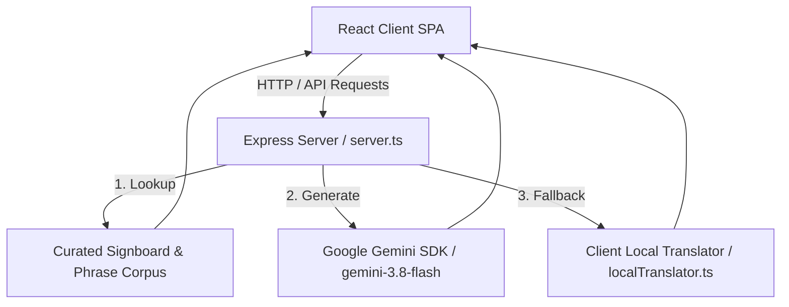

# Namma Kannada AI

AI-Assisted Interactive Kannada Learning & Practical Survival Companion for Karnataka.

[](https://react.dev/)
[](https://www.typescriptlang.org/)
[](https://vitejs.dev/)
[](https://tailwindcss.com/)
[](https://ai.google.dev/)
[](LICENSE)

---

## Project Overview

Namma Kannada AI is a full-stack web application designed to bridge the linguistic gap for non-native speakers, migrants, professionals, and students living, working, or traveling in Karnataka.

Newcomers to urban centers like Bengaluru, Mysuru, or Mangaluru frequently encounter daily communication friction:
- Negotiating fares or routes with auto-rickshaw drivers.
- Ordering meals at local darshinis and restaurants.
- Decoding public notices, traffic regulations, metro maps, and bus destination boards written in Kannada script.
- Understanding Dravidian grammatical conventions, such as Subject-Object-Verb (SOV) sentence structure and cultural honorifics (e.g., appending `-ru` to show respect for elders and mentors).

Namma Kannada AI addresses these challenges by combining verified offline phrasebooks, interactive writing practice, roleplay scenarios, and generative AI powered by the Google Gemini SDK.

---

## Key Features

- **Bilingual Translation Engine**: Translates phrases from English or Hindi into spoken Kannada, providing Roman transliteration, word-by-word vocabulary breakdowns, grammar notes, polite variants, and cultural tips.
- **Multi-Tier Translation Architecture**: Implements a resilient pipeline checking verified local phrase corpora first, falling back to live Gemini AI, and defaulting to a client-side linguistic rule engine to guarantee uptime.
- **Conversational Tutor**: Provides roleplay practice across 10 real-world scenarios (auto-rickshaw negotiation, ordering food, market shopping, asking directions) with AI persona responses, audio pronunciation, and suggested replies.
- **Interactive Writing Lab**: Offers an HTML5 Canvas drawing interface for stroke tracing of Kannada vowels (*Swara*), consonants (*Vyanjana*), conjuncts (*Ottakshara*), and numerals, complete with mastery feedback and confetti.
- **Signboard OCR & Camera Reader**: Inspects traffic regulations, metro signs, and transit notices to provide actionable commuter advice.
- **Structured Survival Curriculum**: Includes a 7-day foundational learning path, flashcard-based spaced repetition memory coaching, and streak tracking.
- **Voice Input & TTS Audio Playback**: Supports voice dictation via the Web Speech API and native audio pronunciation streaming (`/api/tts`).
- **User Authentication & Persistence**: Features bilingual onboarding (English/Hindi), password and OTP authentication simulation, and local storage state persistence.

---

## Technology Stack

| Layer | Technology / Library | Description |
| :--- | :--- | :--- |
| **Frontend** | React 19, TypeScript, Vite 8 | Component-based UI rendering and type-safe state management. |
| **Styling** | Tailwind CSS v4 (`@tailwindcss/vite`) | Utility-first styling framework and responsive design tokens. |
| **Typography** | Google Fonts (*Anek Kannada*, *Plus Jakarta Sans*) | Kannada script rendering and clean UI typography. |
| **Backend** | Node.js, Express.js, `tsx` | Full-stack server proxy, API routing, and static asset serving. |
| **AI Integration** | `@google/genai` (Gemini 3.8 Flash) | Server-side text generation, translation, and structured JSON parsing. |
| **Audio** | Web Speech API, Express TTS Proxy | Browser speech recognition and external TTS audio fetching. |
| **Persistence** | `localStorage` + In-Memory Maps | Client-side user profiles/progress and server-side session/OTP management. |

---

## System Architecture

The application operates as a client-server architecture where the React frontend communicates with an Express backend proxy. The backend manages secure communication with the Google Gemini API while maintaining local fallback mechanisms.



---

## Project Structure

```text
/
├── package.json              # Project dependencies and build scripts
├── server.ts                 # Express backend server and API endpoints
├── vite.config.ts            # Vite bundler configuration
├── index.html                # HTML entry point and font stylesheets
└── src/
    ├── App.tsx               # Root component and tab state router
    ├── main.tsx              # React DOM hydration entry point
    ├── index.css             # Tailwind CSS imports and base styles
    ├── types/
    │   └── index.ts          # TypeScript interfaces and type definitions
    ├── utils/
    │   ├── audio.ts          # Web Speech API and audio playback helpers
    │   ├── i18n.ts           # Bilingual UI dictionary (English/Hindi)
    │   ├── storage.ts        # LocalStorage state management helpers
    │   └── localTranslator.ts# Client-side offline translation fallback engine
    ├── data/
    │   ├── alphabetData.ts   # Kannada character sets (Swara, Vyanjana, Ottakshara)
    │   └── signboardData.ts  # Verified Karnataka signboard corpus and keywords
    └── components/
        ├── Navbar.tsx
        ├── BottomNav.tsx
        ├── HomeDashboard.tsx
        ├── TranslatorSection.tsx
        ├── ConversationalTutor.tsx
        ├── InteractiveWritingLab.tsx
        ├── SurvivalMode.tsx
        ├── RegionalExplorer.tsx
        ├── CameraReaderOCR.tsx
        ├── PhrasebookSection.tsx
        ├── AuthModal.tsx
        └── OnboardingModal.tsx
```

---

## Installation and Setup

### Prerequisites
- Node.js (v18 or higher recommended)
- npm (v9 or higher)

### Setup Instructions

1. Clone the repository:
   ```bash
   git clone https://github.com/your-username/namma-kannada-ai.git
   cd namma-kannada-ai
   ```

2. Install dependencies:
   ```bash
   npm install
   ```

3. Configure environment variables:
   Create a `.env` file in the project root directory based on the required configuration:
   ```env
   PORT=3000
   GEMINI_API_KEY=your_google_ai_studio_api_key
   ```

4. Start the development server:
   ```bash
   npm run dev
   ```

5. Access the application in your browser at `http://localhost:3000`.

---

## Environment Variables

The application requires the following environment variables to run with live AI capabilities:

| Variable | Description | Required |
| :--- | :--- | :--- |
| `PORT` | Port number for the Express server (defaults to `3000`) | No |
| `GEMINI_API_KEY` | API key for Google Gemini model access | Yes (for AI features) |

---

## Usage Guide

1. **Onboarding**: Upon first launch, select your primary source language (English or Hindi), proficiency level, and daily goal.
2. **Translation**: Navigate to the Translator tab to enter English or Hindi phrases and receive instant Kannada script, transliteration, and grammatical breakdowns.
3. **Conversational Roleplay**: Choose a scenario (such as interacting with an auto driver) in the Tutor tab to practice spoken dialogue.
4. **Writing Lab**: Select characters from the alphabet list to practice stroke tracing on the interactive canvas.
5. **Phrasebook**: Save frequently used sentences for quick offline revision.

---

## API Integration

The Express backend exposes RESTful endpoints consumed by the frontend:

- `POST /api/translate`: Accepts text, source language, and translation mode; returns structured translation results.
- `POST /api/chat`: Handles conversational roleplay interactions with persona-specific prompts.
- `GET /api/tts`: Streams audio speech synthesis for Kannada text.
- `GET /api/health`: Reports server status and API key availability.

---

## Error Handling and Fallback Mechanisms

To ensure uninterrupted user experience during network latency or API rate limits:
- **API Timeout Control**: Outbound Gemini requests implement strict timeouts.
- **Corpus Matching**: Common phrases and regulatory signboards are resolved instantly from local dictionaries.
- **Client-Side Fallback**: If the backend is unreachable, `localTranslator.ts` synthesizes linguistic breakdowns and transliterations directly in the browser.

---

## Development and Contribution

Contributions from developers and language enthusiasts are welcome.

1. Fork the repository.
2. Create a feature branch (`git checkout -b feature/name`).
3. Commit your changes following conventional commits (`git commit -m 'feat: add new dialect support'`).
4. Push to the branch (`git push origin feature/name`).
5. Open a Pull Request.

---

## License

This project is licensed under the MIT License. See the [LICENSE](LICENSE) file for details.
